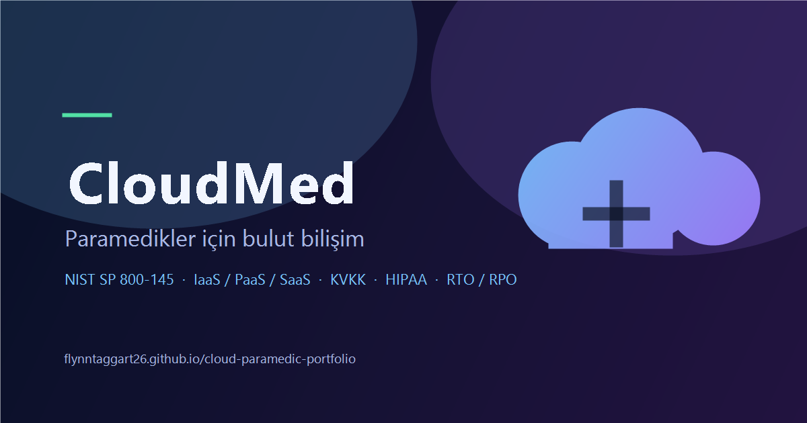

# CloudMed — Cloud Computing for Paramedics

[](https://flynntaggart26.github.io/cloud-paramedic-portfolio/)
[](LICENSE)
[](https://flynntaggart26.github.io/cloud-paramedic-portfolio/)

A single-page reference site that teaches cloud computing to paramedics and field health teams. It connects cloud concepts to decisions made in an ambulance: which service model to use, where patient data may be stored, what happens when the connection drops, and how cost stays under control.

**Live:** https://flynntaggart26.github.io/cloud-paramedic-portfolio/



## Overview

Most cloud material is written for engineers building web products. Field health teams have a different question set: *does this keep working at an incident scene, and is the patient data compliant?* The site is organised around those questions rather than around vendor products.

Content is written in Turkish with English cloud terminology preserved, so the vocabulary matches the contracts, compliance documents and provider consoles teams actually work with.

## What's inside

| Section | Anchor | Covers |
|---|---|---|
| Home | `#ana-sayfa` | End-to-end data path: ambulance tablet → encrypted cloud region → hospital dispatch |
| Fundamentals | `#temeller` | The five NIST SP 800-145 characteristics, field benefits and risks |
| Service models | `#servisler` | IaaS, PaaS, SaaS, FaaS, DBaaS, DaaS and the shared-responsibility split |
| Deployment | `#dagitim` | Public, private, hybrid, community, multi-cloud + decision simulator |
| Providers | `#saglayicilar` | AWS, Azure, Google Cloud; region / availability zone / edge; contract checklist |
| Security | `#guvenlik` | IAM, encryption, observability, HIPAA / GDPR / KVKK / SOC 2 / ISO 27001 |
| Resilience | `#dayaniklilik` | RTO/RPO, 3-2-1 backups, recovery patterns, offline field continuity |
| Cost | `#maliyet` | FinOps loop, hidden cost drivers, budget controls |
| Glossary | `#sozluk` | 19 terms with Turkish/English pairs and primary sources |

### Deployment decision simulator

An interactive model that scores four deployment options against three inputs:

1. **Data sensitivity** — PHI, internal data, or public content.
2. **Outage tolerance** — must work offline, short outages acceptable, or zero tolerance.
3. **Operational capacity** — small team, a few technical staff, or a data centre with specialists.

The result explains the recommended model, lists the reasoning for each answer, states a caveat, and shows the full score breakdown so the logic is inspectable rather than a black box. It is explicitly labelled as educational, not legal or compliance advice.

## Architecture

- **One file, no build step.** All markup, CSS and JavaScript live in `index.html`. There is no bundler, package manager, framework or test runner to install.
- **Progressive enhancement.** Content ships in the HTML. With JavaScript disabled, a `<noscript>` rule reveals every section and hides the tab strip; every fact remains readable and crawlable.
- **Hash routing over a router.** Tabs are buttons wired to `#slug` URLs, giving deep links (`/#guvenlik`), browser history and Back/Forward support without client-side routing code.
- **CSS-only visuals where possible.** The hero diagram is inline SVG; the shared-responsibility split uses flex bars, not a charting library.
- **Single source of truth.** Each fact appears once. The simulator holds scoring rules and rationale, not a duplicate copy of the deployment descriptions.

The deliberate trade-off: inlining everything keeps the site dependency-free and portable, at the cost of a large single document. For a nine-section guide deployed to GitHub Pages, that is the right trade.

## Accessibility and SEO

Verified on the production URL with Lighthouse — **Accessibility 100, Best Practices 100, SEO 100**, no failing audits.

- ARIA tabs pattern (`tablist` / `tab` / `tabpanel`) with `aria-selected`, `aria-controls` and roving `tabindex`.
- Full keyboard support: arrow keys move between tabs, Home/End jump to the ends, focus follows selection.
- Skip link, visible `:focus-visible` rings, `aria-live` simulator results, sequential heading order.
- `prefers-reduced-motion` disables smooth scrolling and animations.
- Semantic tables with `<caption>` and `scope`, labelled form controls, and inline SVG diagrams that expose a `<title>` to assistive technology.
- Meta description, canonical URL, Open Graph and Twitter cards, `og.png` (1200×630), SVG favicon, `theme-color`.

## Privacy

No analytics, cookies or tracking scripts. The only third-party request is Google Fonts (Inter). Patient data appears only as illustrative examples; nothing is collected or transmitted.

## Getting started

No installation required. Serve the directory:

```bash
python -m http.server 8000
```

Then open `http://localhost:8000`. Opening `index.html` directly also works; a local server simply makes hash routing more predictable.

## Deployment

The site is published with GitHub Pages from the root of the `main` branch. `.nojekyll` disables Jekyll processing so files are served verbatim.

```bash
git add -A
git commit -m "Describe the change"
git push origin main
```

Pages typically redeploys within a few minutes of the push.

## Project structure

```
index.html      Site: markup, styles, tab routing, decision simulator
favicon.svg     Browser icon
og.png          Social preview card (1200×630)
docs/           Topic notes, Turkish, matching the site's terminology
LICENSE         MIT
```

`docs/` holds longer-form notes that did not fit in the interface: fundamentals, deployment models, providers and locations, service models, field risks, and the glossary.

## Content guidelines

- Turkish explanations with English terms preserved; this is intentional, not an oversight.
- Provider-specific claims (region counts, certification scope, pricing) are never stated without a dated source. Readers are directed to the current console and the signed contract.
- Compliance sections describe *what to ask for* (BAA/DPA, audit logs, residency clauses), not legal conclusions.
- The site is educational and is not medical or legal advice.

## Sources

- NIST SP 800-145 — *The NIST Definition of Cloud Computing*
- AWS, Microsoft Learn and Google Cloud documentation
- HHS / HIPAA and KVKK regulatory material
- Topic notes: [`docs/`](docs/)

## License

MIT — see [LICENSE](LICENSE).
